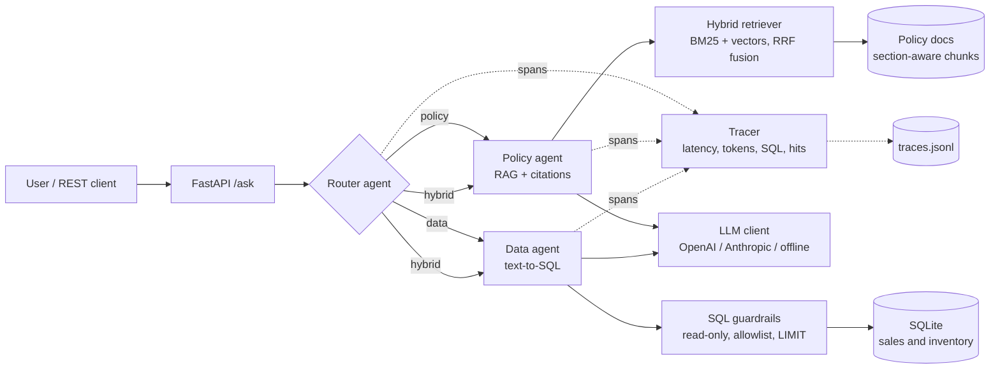
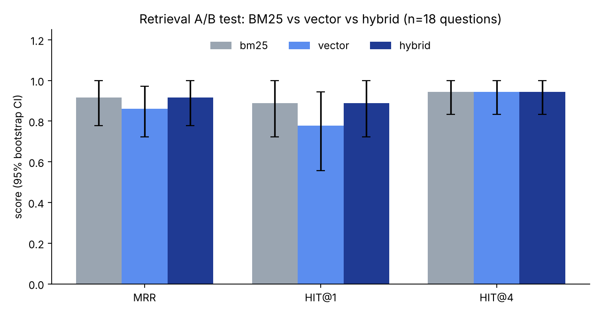

# ShelfSense: a multi-agent AI copilot for retail operations

ShelfSense answers the questions store associates and managers ask every day. Some are about **policy** ("Can a customer return an opened printer?"), some are about **data** ("Which products are below reorder point in Boston?"), and some need **both**. A router agent sends each question to the right specialist. A RAG agent answers from policy documents with citations. A text-to-SQL agent queries a sales and inventory database behind guardrails. Every request is traced, and a statistically grounded eval suite runs in CI.

I built this to practice taking an AI application from prototype to something you could deploy: integrations, guardrails, observability, and evaluation, not just a prompt.

```
$ python -m shelfsense.cli "Which Boston products are running low and what is the rule for when the reorder is submitted?"

[route: hybrid | 3 ms | tokens: 0 | trace: efeaf76d037b44d6]
**Policy:** A product is flagged for reorder when its on-hand quantity at a store is at or below
its reorder point. [1] The weekly replenishment order is submitted every Monday by the inventory lead. [1]

**Data:**
| city   | name                    | on_hand | reorder_point |
|--------|-------------------------|---------|---------------|
| Boston | Wireless Mouse          | 13      | 28            |
| Boston | USB-C Hub               | 8       | 18            |
| Boston | Copy Paper 10-Ream Case | 33      | 42            |
...
Sources: [1] inventory_reorder > Reorder Point
```

## Architecture



| Component | What it does | File |
|---|---|---|
| Router agent | Classifies intent as policy, data, or hybrid. Uses the LLM when configured and falls back to rules if the LLM output can't be parsed. | `agents/router.py` |
| Policy agent | RAG: retrieves chunks, generates a grounded answer that cites sources, and says "I don't know" when the context lacks the answer. | `agents/policy_agent.py` |
| Data agent | Text-to-SQL with one self-correction retry. If the generated SQL fails, the error goes back to the model. | `agents/data_agent.py` |
| SQL guardrails | Single SELECT/CTE statements only, a table allowlist, keyword blocking, and an automatic LIMIT. The database connection is also opened read-only, as a second layer. | `agents/sql_guard.py` |
| Retriever | BM25 (written from scratch), dense vectors (LSA offline, or OpenAI embeddings), and hybrid Reciprocal Rank Fusion. | `retrieval/` |
| LLM client | Provider-agnostic HTTP clients with no vendor SDK, with exponential backoff on 429 and 5xx errors and token accounting. | `llm.py` |
| Observability | A span tree per request (router, agent, retrieval, LLM, SQL) recording latency, tokens, SQL, and retrieved IDs, exported to JSONL and exposed at `/traces/{id}`. | `observability/tracing.py` |
| Evals | A golden set of 26 questions, a retrieval A/B test, bootstrap CIs, a paired permutation test, and a CI quality gate. | `evals/` |

## Quickstart

```bash
# Download: green "Code" button on this page -> Download ZIP (or git clone this repo), then:
cd shelfsense
python -m venv .venv && source .venv/bin/activate
pip install -r requirements.txt
python -m shelfsense.seed_db                 # builds data/retail.db (reproducible, seed=42)

python -m shelfsense.cli "Can a customer return an opened printer?"
python -m shelfsense.cli                     # interactive mode
uvicorn shelfsense.api:app --reload          # REST API, docs at http://localhost:8000/docs
pytest -q                                    # 24 tests
python -m shelfsense.evals.run_evals         # writes reports/
```

**Use a real LLM:** copy `.env.example` to `.env`, then set `LLM_PROVIDER=openai` or `anthropic` and add the API key. With no key, everything runs in **offline mode**: deterministic, free, and CI-friendly. The router falls back to rules, the policy agent answers extractively (it quotes the source sentences), and the data agent uses parameterized query templates.

**Docker:** `docker build -t shelfsense . && docker run -p 8000:8000 shelfsense`

```bash
curl -X POST localhost:8000/ask -H 'content-type: application/json' \
     -d '{"question": "What are the top 3 products by revenue in Edison?"}'
```

## Evaluation

Small eval sets give noisy numbers. So every metric is reported with a **95% bootstrap confidence interval**, and retrieval strategies are compared with a **paired permutation test** on the same questions rather than by eyeballing averages.

Results in offline mode (`reports/eval_report.md`):

| Metric | n | Mean [95% CI] |
|---|---|---|
| Routing accuracy | 26 | 0.96 [0.88, 1.00] |
| SQL execution accuracy (result set equals the reference query's) | 10 | 1.00 [1.00, 1.00] |
| Answer keyword recall (required facts present) | 18 | 0.89 [0.72, 1.00] |
| Groundedness (answer sentences supported by the retrieved context) | 18 | 0.90 [0.76, 1.00] |



**What the A/B test says:** hybrid retrieval matched BM25 (MRR 0.92) and beat pure vector search on hit@1 (0.89 vs 0.78). However, the difference is **not statistically significant** (p = 0.49, n = 18). The honest conclusion is "hybrid is no worse and is more robust," not "hybrid wins." Telling those two claims apart takes a larger eval set.

**Failure analysis.** The eval caught two real problems:
- `p08` *"How many cartridges can a member recycle each month?"*: "how many" pushed the rule-based router to the data agent. This is a known weakness of keyword routing, and the LLM router fixes it.
- `p16` *"Can I give a refund when the customer lost the slip?"*: "slip" never appears in the policy text, so lexical retrieval misses the paraphrase. Semantic embeddings in LLM mode are the fix. This is exactly the case where dense retrieval earns its place.

**CI quality gate:** GitHub Actions runs the tests and the eval suite on every push. The build fails if the *lower bound* of the CI for routing, SQL accuracy, or keyword recall falls below its threshold, so a regression can't hide inside noise.

## Design decisions

- **Offline-first.** Every agent has a deterministic fallback, so the system is testable without API keys or spend, and the LLM path is an upgrade rather than a dependency.
- **Defense in depth for SQL.** The validator and the read-only connection are separate layers, so model output never gets write access.
- **Citations by construction.** Chunks are section-aware, so a citation reads like `returns_policy > Electronics and Technology`, which a store associate can verify.
- **No framework lock-in.** Routing, RAG, and tracing are about 700 lines of readable Python. Mapping them onto LangGraph, LlamaIndex, or OpenTelemetry is straightforward once the concepts are clear.

## Roadmap

- [ ] LLM-as-judge faithfulness scoring alongside the deterministic groundedness proxy
- [ ] Swap the in-memory vector index for pgvector or Chroma, and add a reranker
- [ ] Grow the golden set to 100+ questions so A/B tests have statistical power
- [ ] Add conversation memory for follow-up questions
- [ ] Export spans to OpenTelemetry / Grafana

## Data

All data is **synthetic**. The policies describe a fictional retailer, and sales and inventory are generated by `seed_db.py` (Poisson demand with weekday and seasonal effects, 5 stores, 20 products, Q1 2026).

MIT License
